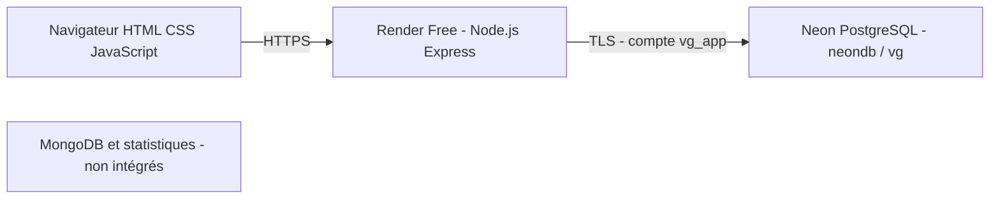

# Vite & Gourmand

Application pédagogique ECF Studi de consultation et de commande de menus pour
un traiteur fictif à Bordeaux. Menus, prix, illustrations, avis et prestations de
démonstration ne constituent pas une offre commerciale réelle.

- **Application :** https://vite-et-gourmand-y9b8.onrender.com/
- **Catalogue :** https://vite-et-gourmand-y9b8.onrender.com/menus.html
- **Code public :** https://github.com/abdoudoye/vite-et-gourmand
- **Connexion :** https://vite-et-gourmand-y9b8.onrender.com/connexion.html

## État actuel et niveaux de preuve - 18 novembre 2026

Le backend Node.js/Express est déployé sur **Render Free**. PostgreSQL est hébergé
sur **Neon**, base `neondb`, schéma `vg`. Les connexions client, employé et
administrateur ainsi que le catalogue, le parcours client et la réservation du
stock ont été confirmés en production par le porteur du projet.

| Périmètre | Fonctionnalité développée | Test automatisé réussi | Validation en production / limite |
| --- | --- | --- | --- |
| Catalogue | Fiches, plats/allergènes, filtres combinables sans rechargement | Inclus dans les 163 tests | Catalogue fonctionnel confirmé |
| Inscription et connexion | Client actif dès inscription, Argon2id, sessions et contrôle des rôles | Inclus dans les 163 tests | Connexions des trois rôles confirmées ; aucun email d'activation exigé |
| Commandes client | Devis, prorata, remise, confirmation, modification/annulation avant acceptation, historique | Prix, droits, transactions, stock et rejeux couverts | Parcours client et réservation confirmés ; recette exhaustive de chaque action encore à compléter |
| Espace employé | Consultation, filtres, acceptation/refus avec contact et motif | Droits, concurrence simulée, historique et restitution couverts | Connexion confirmée ; acceptation/refus validés localement, recette complète sur Neon à compléter |
| Administration | Employés, modification des menus/stock, modération des avis | Autorisations et opérations sensibles couvertes | Connexion confirmée ; chaque opération métier reste à recetter sur Neon |
| Avis | Dépôt après commande terminée, modération admin et lecture publique filtrée | Règles et API couvertes | Parcours complet non validé : transitions jusqu'à `terminee` incomplètes |
| E-mails | Notification en base et transport SMTP conditionnel | Transport simulé uniquement | **Envois réels désactivés** : `EMAIL_MODE=disabled` |
| Statistiques NoSQL | Analyse documentée seulement | Aucun test de statistiques fonctionnelles | **MongoDB et statistiques non développés** |

Dernier audit automatisé : **163 tests réussis, aucun échec**. Ce résultat provient
de la dernière exécution consignée, pas d'une nouvelle exécution pendant cette
mise à jour documentaire. Les tests utilisent PGlite en mémoire, des clients SQL
simulés et des serveurs HTTP de test ; ils ne constituent pas une recette complète
sur Neon. Les validations historiques sur PostgreSQL local restent distinctes.

## Architecture et organisation



Le frontend et l'API sont servis par le même Express. Le navigateur ne se connecte
jamais directement à PostgreSQL. Les comptes métier `utilisateur`, `employe` et
`administrateur` sont différents des rôles techniques `vg_owner`, `vg_migrator`
et `vg_app`.

| Répertoire | Contenu |
| --- | --- |
| `frontend/` | Pages HTML, styles, JavaScript natif et illustrations fictives |
| `backend/` | Serveur Express, services métier, accès SQL et tests |
| `database/` | Schéma, seed fictif, profils de permissions et documentation |
| `docs/` | Guides techniques et procédure de déploiement |

Stack : Node.js (version locale testée **26.13.0**), npm, Express, PostgreSQL et
Argon2id. MongoDB Atlas reste une cible prévue, pas une intégration disponible.

## Installation locale

Prérequis : Node.js/npm, Git et une base PostgreSQL locale dédiée, déjà initialisée
et autorisée pour `vg_app`. Les fichiers de configuration locaux ne sont pas dans
Git. Ne jamais copier les secrets de production dans une documentation ou un dépôt.

Depuis la racine du dépôt cloné :

```powershell
npm.cmd --prefix backend ci
if (-not (Test-Path -LiteralPath .env)) { Copy-Item .env.example .env }
```

Renseigner les valeurs privées dans `.env`, sans écraser une configuration
existante. Exemple de configuration non secrète pour le développement :

| Variable | Usage local |
| --- | --- |
| `HOST`, `PORT` | `127.0.0.1`, `3000` par défaut |
| `DB_HOST`, `DB_PORT` | Hôte local et port PostgreSQL, généralement `127.0.0.1`, `5432` |
| `DB_NAME` | Nom réel de la base locale ; installation historique : `vite_et_gourmand` |
| `DB_USER` | `vg_app`, imposé par le backend |
| `DB_PASSWORD` | Secret privé du compte applicatif, jamais versionné |
| `DB_SSL` | `false` seulement en boucle locale ; `true` obligatoire à distance |
| `NODE_ENV`, `SESSION_STORE` | `development`, `memory` pour une démonstration locale ; mémoire perdue au redémarrage |
| `EMAIL_MODE` | `disabled` |
| `ORDER_EXTRA_PRICING` | `prorata` |
| `ORDER_TERMS_VERSION` | `DEMO-conditions-v1` |

Avec `SESSION_STORE=postgres`, la table `vg.web_sessions` de 008 doit exister et
un `SESSION_SECRET` stable doit être configuré. Les variables déjà définies dans
le processus priment sur `.env`. `DATABASE_URL` n'est pas utilisée par le backend.

```powershell
node backend/server.js
```

Ouvrir http://127.0.0.1:3000/menus.html. Sans configuration SQL, les pages statiques
restent accessibles mais les API dépendantes de la base répondent 503. La racine
`/` affiche encore un accueil provisoire ; elle n'est pas une page d'accueil achevée.

L'installation d'une **nouvelle base vide** est une opération séparée à faire
relire et autoriser. `000_create_local_database.sql` crée une base locale nommée
`vite_gourmand_demo` ; ce script n'est pas un bootstrap Neon. Les scripts de
provisionnement de comptes du backend imposent la base locale `vite_et_gourmand`
et ne doivent pas être lancés tels quels sur `neondb`.

Ne rejouer ni seed ni migration sur une base déjà initialisée. Ne pas rétablir le
profil large de 003 après les permissions restreintes. Voir le
[schéma et les règles SQL](database/SCHEMA.md) et le
[guide de déploiement](docs/DEPLOIEMENT.md).

## Parcours et règles de commande

Le catalogue charge `/api/menus` depuis PostgreSQL ; `frontend/data/menus.json`
est une référence de test, pas une solution de repli. Les filtres couvrent prix
maximum, fourchette de prix, thème, régime et taille du groupe compatible avec
le minimum du menu. Le catalogue déjà ouvert conserve un instantané en mémoire :
les filtres ne rechargent pas le stock ; l'API répond `Cache-Control: no-store`.

1. Sélectionner un menu ne réserve rien. Une session client est nécessaire pour
   accéder au formulaire ; le menu choisi est conservé pendant la connexion.
2. Calculer le prix crée un devis temporaire, sans réservation.
3. **Confirmer et réserver** crée la commande `en_attente` et réserve **une unité**
   dans la même transaction : le stock compte des commandes, pas des personnes.
4. L'acceptation employé ne décrémente pas une seconde fois. Une modification
   conserve la réservation ; annulation autorisée/refus restitue une unité, avec
   protections contre les rejeux et les doubles restitutions.

Le prorata est une **décision de projet approuvée** : prix du minimum multiplié
par personnes/minimum, arrondi au centime, puis remise de 10 % à partir de
minimum + 5 personnes. La livraison est ajoutée après la remise. Exemple fictif :
180 EUR pour 6 personnes, 11 personnes donnent 330 EUR brut, 33 EUR de remise et
297 EUR hors livraison. À Bordeaux, livraison gratuite selon les critères du
serveur ; hors Bordeaux, 5 EUR + 0,59 EUR/km exigent une distance vérifiée, sourcée
et non expirée en base. Aucun kilométrage n'est inventé.

Les commandes de démonstration historiques du seed ne sont pas des confirmations
applicatives et n'ont pas réservé de stock par ce parcours. Sans relevé antérieur
ou journal des mouvements, ne pas reconstituer un stock passé en soustrayant
simplement toutes les commandes. Certains textes pédagogiques du seed sur les
suppléments restent à actualiser séparément ; aucune donnée n'est changée ici.

## Sécurité et accès de démonstration

- Mots de passe applicatifs Argon2id ; contrôles serveur, requêtes paramétrées et
  autorisations relues pour les comptes actifs à chaque action protégée.
- Compte SQL partagé `vg_app` à droits ciblés ; aucune politique RLS n'est annoncée.
- TLS vérifié à distance ; en production, sessions PostgreSQL et cookie
  `__Host-vg.sid`, `Secure`, `HttpOnly`, `SameSite=Lax`, durée maximale deux heures.
- Mutations de session/commandes/administration protégées par l'en-tête dédié,
  la comparaison d'origine et Fetch Metadata ; aucune désactivation générale CSRF.
- L'inscription publique crée seulement un client actif. L'e-mail désactivé ne
  bloque pas le compte et aucune confirmation par e-mail n'est requise.

Les connexions des trois rôles de démonstration sont confirmées par le porteur.
Les mots de passe du jury sont transmis **hors du dépôt public**, dans une annexe
confidentielle remise via Studi. Aucun secret PostgreSQL ou de session ne doit y
figurer. Voir le [provisionnement hors inscription](docs/PROVISION_ADMIN_FICTIF.md).
Ces protections ne constituent pas une certification RGPD ou RGAA complète.

## Tests et vérifications

```powershell
npm.cmd --prefix backend test
git diff --check
```

Les 163 tests du dernier audit couvrent notamment prix, droits, sessions, SQL,
Argon2id, stock, idempotence, rollbacks et interfaces simulées. Les scénarios de
concurrence PGlite ne remplacent pas une recette multi-connexions PostgreSQL réelle.

Lectures de santé, sans nouvelle commande ni création de compte :

```powershell
Invoke-RestMethod https://vite-et-gourmand-y9b8.onrender.com/api/health/db
Invoke-RestMethod https://vite-et-gourmand-y9b8.onrender.com/api/menus
```

La santé DB renvoie 200 et `status: ok` si sa lecture réussit, sinon 503. Elle ne
valide pas tous les parcours. Toute connexion utilisateur peut écrire une session ;
toute inscription, commande ou décision métier exige une recette autorisée.

## Déploiement et limites connues

La production utilise Render Free et Neon `neondb`/`vg`. Les huit scripts appliqués
sont **001, 002, 004, 007, 008, 009, 010, 011**. Le contrôle indépendant a confirmé
24 tables, une vue, cinq fonctions et sept triggers. Les comptes actifs ont été
provisionnés séparément du seed. Aucune migration ne s'exécute au démarrage.

Le [guide Render/Neon](docs/DEPLOIEMENT.md) décrit build, démarrage, variables privées,
TLS, proxy et vérifications. Render Free peut se mettre en veille ; son redémarrage
et celui de Neon peuvent retarder la première visite. Un envoi SMTP n'est pas une
fonctionnalité validée de cette démonstration.

Restent incomplets ou absents : MongoDB/statistiques, accueil complet avec avis,
contact, réinitialisation de mot de passe, modification du profil client, suivi
livraison/retour matériel, gestion complète des plats/horaires/galerie et modération
par l'employé. L'API d'avis existe, mais le parcours normal jusqu'à `terminee`
reste incomplet. Les distances hors Bordeaux et les opérations administratives
nécessitent encore leur recette ciblée. Aucun envoi réel d'e-mail n'est annoncé.

## Documentation technique et historique

- [Architecture et déploiement Render/Neon](docs/DEPLOIEMENT.md)
- [Modèle PostgreSQL, contraintes et transactions](database/SCHEMA.md)
- [Commandes, tarification et livraison](docs/COMMANDES.md)
- [Espace employé et décisions](docs/ESPACE_EMPLOYE.md)
- [Administration et limites NoSQL](docs/ADMINISTRATION.md)
- [Comptes de démonstration et procédure locale historique](docs/PROVISION_ADMIN_FICTIF.md)

Les comptes rendus [d'inscription](database/REGISTRATION_AUDIT.md) et de
[réparation UTF-8 locale](database/repairs/README.md) sont des archives datées.
Ils ne décrivent pas l'état actuel de Neon et ne doivent pas être rejoués.
Le sujet officiel et la notice Studi sont fournis hors dépôt. Charte, maquettes,
manuel PDF et lien de suivi de projet restent des livrables distincts : leur
présence n'est pas déduite de ces documents techniques.
