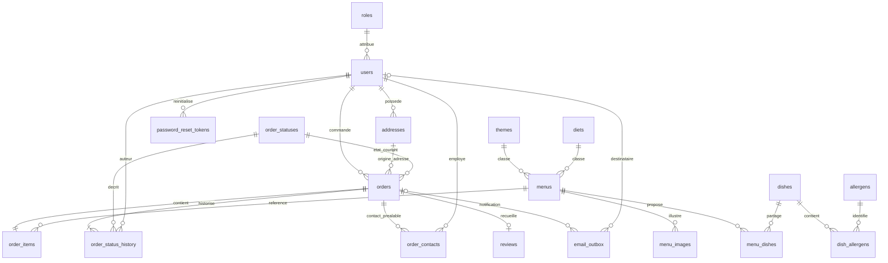

# Schéma PostgreSQL proposé

Source métier : sujet officiel Studi fourni hors dépôt, pages 4 à 9 et livrables
pages 11 à 12. Les scripts ciblent PostgreSQL 16 ou supérieur ; l'installation
déclarée utilise désormais PostgreSQL 18.6 et la base existante `vite_et_gourmand`.
Les scripts `001`, `002`, `003` sont déclarés appliqués : ne pas les rejouer au démarrage.
Le schéma `vg` évite de mélanger les tables du projet
avec `public`. Les scripts n'ont aucune opération de suppression de schéma/table.

## Relations et tables

| Tables | Champs et rôle principaux |
| --- | --- |
| `roles`, `users` | Un rôle par compte, identité, téléphone, e-mail unique sans tenir compte de la casse, hachage Argon2id/bcrypt uniquement, activation, créateur, désactivation. |
| `addresses` | Plusieurs adresses par personne ; au plus une adresse active par défaut. |
| `password_reset_tokens` | Empreinte SHA-256 du jeton, expiration et utilisation ; jamais le jeton brut. |
| `themes`, `diets`, `menus` | Conditions de commande/conservation, minimum, prix pour ce minimum, stock en commandes possibles, archivage. |
| `menu_images` | Galerie ordonnée, chemin, légende et texte alternatif. |
| `dishes`, `menu_dishes` | Catégorie entrée/plat/dessert, association N–N ; un même plat peut figurer dans plusieurs menus. |
| `allergens`, `dish_allergens` | Allergènes attachés au plat, association N–N. |
| `orders` | Client, copie des coordonnées et de l'adresse, prestation/livraison, frais, distance sourcée, CGV acceptées, statut, auteur, annulation, prêt de matériel. |
| `order_items` | Un menu par commande, personnes, copie du minimum/prix/titre/conditions, règle tarifaire, montant avant réduction, réduction, net calculé. |
| `order_statuses`, `order_status_history` | Codes stables, libellés français, date/heure, auteur et motif ; insertion automatique lors de la création et des changements de statut. |
| `order_contacts` | Téléphone/e-mail, employé, date, motif et action envisagée avant modification/annulation. |
| `reviews` | Un avis par commande, note 1–5, commentaire, état et auteur/date de modération. |
| `opening_hours` | Une plage par jour ISO (lundi=1, dimanche=7), ou jour fermé. Hypothèse simple ; plusieurs plages nécessiteraient une évolution. |
| `email_outbox` | Notifications à envoyer, destinataire, type, état, date d'envoi et tentatives. Aucun service d'e-mail n'est configuré. |

La vue `order_totals` additionne la ligne nette et la livraison sans dupliquer un
total modifiable. Les montants sont en centimes entiers ; les totaux sont élargis en
`bigint`. Dates/heures d'événement : `timestamptz`, à afficher en Europe/Paris.

## Intégrité assurée par SQL

- Identifiants `bigint GENERATED ALWAYS AS IDENTITY` ; clés composées pour les
  associations ; clés étrangères et suppressions restreintes sur les commandes.
- Index sur les filtres catalogue et commandes, les e-mails normalisés, les clés
  étrangères utiles, l'historique chronologique et les notifications en attente.
  Les clés primaires et contraintes `UNIQUE` créent déjà leurs index.
- Minimum, stock et montants contrôlés ; exactement une ligne par commande grâce
  à une unicité et une vérification différée en fin de transaction.
- À l'insertion d'une ligne, copie automatique des valeurs du menu ; menu et
  valeurs historiques non remplaçables ensuite. Archiver un menu commandé plutôt
  que le supprimer ; ne pas réécrire les commandes après une modification du catalogue.
- Au minimum de personnes, le prix brut doit correspondre au prix de base copié.
  Réduction de 10 % à partir de minimum + 5 ; calcul arrondi au centime.
- Livraison Bordeaux : 0 centime, pas de distance. Hors Bordeaux : distance
  non négative avec source obligatoire et frais `500 + arrondi(distance_km × 59)`.
  La source devra être vérifiée par le serveur ; un champ texte ne prouve pas une distance.
- Statut initial et changements historisés automatiquement. Le compte applicatif
  ne peut pas écrire directement dans l'historique ni supprimer les commandes.
- Les comptes de démonstration sont désactivés, sans hachage ni mot de passe.
  Un compte actif exige un hachage ; la contrainte de préfixe ne garantit pas sa validité
  cryptographique. Le backend devra produire/vérifier les hachages avec une bibliothèque adaptée.

## Exigences, décisions et points restant à développer

**Exigences Studi :** menus, galerie, plats partagés, allergènes par plat, minimum,
prix associé, stock, comptes/rôles, coordonnées, commandes, suivi horodaté, remise,
conditions, avis modérés, contacts préalables et restitution du matériel.

**Décisions du projet :** un seul rôle par utilisateur ; une seule ligne de menu
par commande (le sujet utilise le singulier) ; trois rôles PostgreSQL distincts ;
archivage du catalogue utilisé dans l'historique ; arrondissement commercial au
centime ; tables de support pour les réinitialisations et notifications.
`en_attente`, `annulee` et `refusee` complètent les statuts de suivi du sujet.

**Tarification supplémentaire :** aucune formule n'est supposée. `pricing_policy`
et `gross_amount_cents` permettent d'enregistrer une règle approuvée plus tard.
Les démonstrations SQL portent seulement sur le minimum de personnes. Le test de
remise utilise une somme fictive de test, pas un prix commercial ni une règle adoptée.

**Distance :** la méthode réelle reste à choisir (fournisseur d'itinéraires ou saisie
justifiée contrôlée par un employé). Aucune distance réelle n'est inventée. Les
démonstrations SQL sont à Bordeaux et les distances des tests portent la mention fictive.

**Stock :** nombre de commandes encore possibles pour ce menu, pas un nombre de
portions. Le futur serveur devra réserver/décrémenter atomiquement et libérer lors
d'une annulation, dans une transaction. Les données actuelles sont statiques et ne
reconstituent pas un stock initial à partir des commandes de démonstration.

**Filtre personnes :** le champ désigne la taille du groupe ; `minimum_people <=
taille_du_groupe`. Ce sens n'est pas précisé par l'énoncé et reste notre choix documenté.

**À imposer dans les futurs services serveur, non fourni par ce schéma seul :**

- Autorisations et rôle actif à chaque action ; l'inscription publique fixe
  `utilisateur`. Création initiale d'administrateur hors inscription, avec un hachage
  généré localement et sans secret versionné. Aucun administrateur n'est créé par le seed.
- Validation du téléphone/e-mail/adresse, robustesse du mot de passe avant hachage,
  limitation d'abus, sessions, consommation atomique d'un jeton non expiré à usage unique.
- Vérification que l'adresse appartient au client et copie de ses coordonnées au
  moment de la validation ; règles RGPD de conservation/anonymisation à définir.
- Authentification obligatoire, commande et ligne insérées ensemble, vérification
  du menu actif, du stock et de la tarification approuvée. La DB ne vérifie pas que
  le client a réellement accepté les CGV : le parcours doit recueillir cet accord.
- Transitions autorisées des statuts, modifications client seulement avant acceptation,
  contact préalable obligatoire de l'employé et motif d'annulation ; les tables
  conservent les preuves mais ne remplacent pas les contrôles d'autorisation.
- Avis uniquement après une commande terminée et affichage public uniquement si validé.
- Calcul des 10 jours **ouvrés** selon un calendrier explicite, notification de
  restitution, prêt et retour effectifs ; pénalité prévue : 60 000 centimes (600 €).
- Envoi des notifications via une file traitée après transaction ; aucun envoi depuis
  les scripts SQL ni les tests. Ne pas envoyer de mot de passe ou jeton brut dans les journaux.
- Statistiques graphiques provenant de **MongoDB**, à alimenter depuis les événements
  de commandes. PostgreSQL conserve les faits ; cette étape ne crée pas MongoDB.

## Séparation des droits PostgreSQL

- `vg_owner` : propriétaire **NOLOGIN** du schéma et des objets.
- `vg_migrator` : connexion réservée à l'initialisation manuelle, membre de `vg_owner`.
- `vg_app` : connexion d'application **sans** superutilisateur, création de base/rôle,
  propriété ou appartenance au propriétaire. Droits DML ciblés, aucun droit DDL.

Les rôles métier `utilisateur/employe/administrateur` de la table `roles` sont
différents de ces comptes techniques. Le compte applicatif est partagé par le
backend ; il n'isole pas à lui seul les clients. Les identifiants de migration ne
doivent jamais être placés dans le `.env` de l'application.

Le backend possède maintenant un pool `pg` et deux routes en lecture seule :
`GET /api/health/db` et `GET /api/menus`. Le compte et ses privilèges effectifs sont
contrôlés avant chaque requête. Le catalogue sélectionne les menus fictifs non
archivés, leurs images, plats et allergènes, dans le contrat attendu par le frontend.
La configuration et les erreurs brutes ne sont pas exposées. Cette intégration ne
modifie pas le schéma et n'applique aucune migration ; les règles d'authentification
et de commande listées plus haut restent à développer.

Références techniques : [contraintes PostgreSQL](https://www.postgresql.org/docs/current/ddl-constraints.html),
[chargement .env Node.js](https://nodejs.org/api/process.html#processloadenvfilepath),
[PGlite en mémoire pour les tests](https://pglite.dev/docs/).
