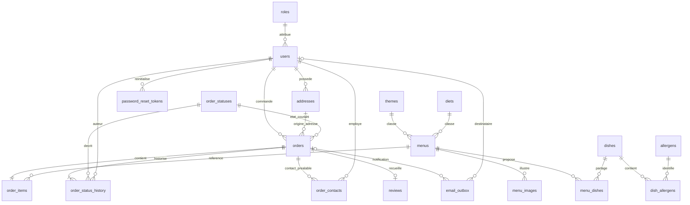

# Schéma PostgreSQL et règles serveur

Source métier : sujet officiel Studi fourni hors dépôt, pages 4 à 9 et livrables
pages 11 à 12. Les scripts ciblent PostgreSQL 16 ou supérieur ; l'installation
déclarée utilise désormais PostgreSQL 18.6 et la base existante `vite_et_gourmand`.
Les scripts `001`, `002`, `003` sont déclarés appliqués historiquement ; les droits
ont ensuite été restreints et complétés. **009, 010 et 011 ont été appliqués sur
PostgreSQL local**, selon les confirmations du porteur du projet. Leurs objets et
permissions ont été contrôlés en lecture seule. Ne pas les rejouer au démarrage,
ni rétablir le profil large de 003 après les restrictions de 004.
Le schéma `vg` évite de mélanger les tables du projet
avec `public`. Les scripts n'ont aucune opération de suppression de schéma/table.

## État des preuves — 17 novembre 2026

- **Fonctionnalité développée :** authentification, devis et commandes, prix,
  transactions de stock, décisions employé, administration et avis dans le périmètre
  décrit ci-dessous. Un champ prévu dans le schéma ne suffit pas à établir qu'un
  parcours est développé ; c'est notamment le cas du suivi de livraison/matériel.
- **Test automatisé réussi :** dernière suite complète de 163 tests, sans échec,
  avec PGlite en mémoire et clients simulés. Les tests de prix, droits et stock
  réussissent ; ils ne se connectent pas à PostgreSQL installé.
- **Validation sur PostgreSQL local :** fonctionnement des comptes client,
  employé et administrateur et du parcours client confirmé par le porteur ;
  acceptation/refus vérifiés localement. Les recettes exhaustives d'administration,
  de concurrence multi-connexions et de distance réelle restent à effectuer.
- **Déploiement public :** non réalisé. La cible gratuite Neon/Render/Atlas est
  une architecture validée, pas une infrastructure déjà créée ou testée.

Les anciens comptes rendus, dont `REGISTRATION_AUDIT.md`, sont des photographies
datées de l'installation et non une liste actuelle des migrations à appliquer.

## Relations et tables

| Tables | Champs et rôle principaux |
| --- | --- |
| `roles`, `users` | Un rôle par compte, identité, téléphone, e-mail unique sans tenir compte de la casse, hachage Argon2id/bcrypt uniquement, activation, créateur, désactivation. |
| `addresses` | Plusieurs adresses par personne ; au plus une adresse active par défaut. |
| `password_reset_tokens` | Structure prévue pour empreinte SHA-256, expiration et utilisation ; le parcours de réinitialisation n'est pas développé. |
| `themes`, `diets`, `menus` | Conditions de commande/conservation, minimum, prix pour ce minimum, stock en commandes possibles, archivage. |
| `menu_images` | Galerie ordonnée, chemin, légende et texte alternatif. |
| `dishes`, `menu_dishes` | Catégorie entrée/plat/dessert, association N–N ; un même plat peut figurer dans plusieurs menus. |
| `allergens`, `dish_allergens` | Allergènes attachés au plat, association N–N. |
| `orders` | Client, copie des coordonnées et de l'adresse, prestation/livraison, frais, distance sourcée, CGV acceptées, statut, auteur, annulation, prêt de matériel. |
| `order_items` | Un menu par commande, personnes, copie du minimum/prix/titre/conditions, règle tarifaire, montant avant réduction, réduction, net calculé. |
| `order_statuses`, `order_status_history` | Codes stables, libellés français, date/heure, auteur et motif ; insertion automatique lors de la création et des changements de statut. |
| `order_contacts` | Téléphone/e-mail, employé, date, motif et action envisagée avant modification/annulation. |
| `reviews` | Un avis par commande, note 1–5, commentaire, état et auteur/date de modération. |
| `opening_hours` | Une plage par jour ISO (lundi=1, dimanche=7), ou jour fermé. Hypothèse simple ; plusieurs plages nécessiteraient une évolution. |
| `email_outbox` | Notifications à envoyer, destinataire, type, état, date d'envoi et tentatives. Envoi SMTP conditionnel développé ; réception d'e-mails réels non validée, reprise automatique absente. |
| `order_quotes`, `order_receipts` (009) | Devis temporaires et reçus d'idempotence pour éviter les doubles confirmations ; présents localement. |
| `delivery_distances` (009) | Distance vérifiée, source, vérificateur et expiration ; lecture seule pour `vg_app`, sans kilomètres inventés. |
| `web_sessions` (008) | Stockage des sessions PostgreSQL développé et testé en mémoire ; table absente au dernier audit local, mode mémoire actuellement utilisé. |

La vue `order_totals` additionne la ligne nette et la livraison sans dupliquer un
total modifiable. Les montants sont en centimes entiers ; les totaux sont élargis en
`bigint`. Dates/heures d'événement : `timestamptz`, à afficher en Europe/Paris.

## Intégrité assurée par SQL

- Identifiants `bigint GENERATED ALWAYS AS IDENTITY` ; clés composées pour les
  associations ; clés étrangères et suppressions restreintes sur les commandes.
- Index sur les filtres catalogue et commandes, les e-mails normalisés, les clés
  étrangères utiles, l'historique chronologique et les notifications en attente.
  Les clés primaires et contraintes `UNIQUE` créent déjà leurs index.
- Minimum, stock et montants contrôlés ; exactement une ligne par commande grâce
  à une unicité et une vérification différée en fin de transaction.
- À l'insertion d'une ligne, copie automatique des valeurs du menu ; menu et
  valeurs historiques non remplaçables ensuite. Archiver un menu commandé plutôt
  que le supprimer ; ne pas réécrire les commandes après une modification du catalogue.
- Au minimum de personnes, le prix brut doit correspondre au prix de base copié.
  Réduction de 10 % à partir de minimum + 5 ; calcul arrondi au centime.
- Livraison Bordeaux : 0 centime, pas de distance. Hors Bordeaux : distance
  non négative avec source obligatoire et frais `500 + arrondi(distance_km × 59)`.
  Le serveur exige déjà une entrée sourcée et non expirée dans `delivery_distances` ;
  un champ texte ou une distance de test ne prouve pas un itinéraire réel.
- Statut initial et changements historisés automatiquement. Le compte applicatif
  ne peut pas écrire directement dans l'historique ni supprimer les commandes.
- Les comptes du seed 002 sont désactivés, sans hachage ni mot de passe. Des
  comptes fictifs actifs ont été provisionnés séparément pour les essais locaux ;
  ils ne sont pas créés par le seed et leurs secrets ne figurent pas dans Git.
  Un compte actif exige un hachage ; la contrainte de préfixe ne garantit pas sa validité
  cryptographique. Le backend produit et vérifie les hachages avec Argon2id ;
  la présence de la contrainte SQL ne remplace pas cette vérification.

## Exigences, décisions et points restant à développer

**Exigences Studi :** menus, galerie, plats partagés, allergènes par plat, minimum,
prix associé, stock, comptes/rôles, coordonnées, commandes, suivi horodaté, remise,
conditions, avis modérés, contacts préalables et restitution du matériel.

**Décisions du projet :** un seul rôle par utilisateur ; une seule ligne de menu
par commande (le sujet utilise le singulier) ; trois rôles PostgreSQL distincts ;
archivage du catalogue utilisé dans l'historique ; arrondissement commercial au
centime ; tables de support pour les réinitialisations et notifications.
`en_attente`, `annulee` et `refusee` complètent les statuts de suivi du sujet.

**Tarification supplémentaire — règle de projet approuvée et développée :**
le sujet donne un prix pour le minimum, sans préciser entièrement le supplément.
Le porteur a validé le prorata : pour `n` personnes et un minimum `m`,
`brut = arrondi_centime(prix_minimum × n / m)`. La quantité ne peut être inférieure
au minimum. La remise de 10 % sur ce brut est appliquée dès `n >= m + 5`, puis
arrondie au centime. La livraison est ajoutée après remise ; elle n'en bénéficie pas.
Les calculs utilisent des centimes entiers/BigInt et `pricing_policy` mémorise
la règle appliquée. Le SQL vérifie notamment le montant au minimum et la remise,
mais le prorata est calculé et contrôlé par le serveur.

Exemple fictif testé : 180 € pour 6 personnes, commande de 11 personnes :
330 € brut, remise de 33 €, net menu de 297 €. Ces prix ne sont pas des offres
commerciales. Les tests automatisés couvrent minimum, seuil, arrondis et livraison ;
ils ne prouvent pas une facturation ou une livraison publique réellement effectuée.

**Distance — traitement développé, preuve réelle à compléter :** Bordeaux est
gratuit selon la ville et les codes postaux contrôlés par le serveur. Hors Bordeaux,
les frais valent `500 + arrondi(distance_km × 59)` centimes. Le serveur retrouve
une distance dans `delivery_distances` à partir de l'adresse normalisée, exige
une source et une validité non expirée, et refuse le devis si elle manque. Un
opérateur autorisé doit vérifier l'itinéraire et documenter le point de départ
et la convention de trajet avant alimentation. Aucune distance réelle n'est
inventée ; les démonstrations SQL sont à Bordeaux et les distances des tests
sont fictives. Une validation locale de livraison hors Bordeaux avec source
réelle et le déploiement public ne sont pas déclarés réalisés.

**Stock — transactions développées :** nombre de commandes encore possibles pour
ce menu, pas un nombre de portions. La consultation du catalogue, la sélection et
le devis ne réservent rien. La confirmation relit le menu sous verrou, recontrôle
le devis et décrémente une unité si `stock_available > 0`. Réservation, commande,
ligne, historique automatique, notification et reçu d'idempotence sont validés
ensemble ou annulés par rollback. Le rejeu d'une confirmation ne réserve pas deux fois.

Une modification client avant acceptation garde le menu et la réservation.
L'acceptation ne change pas le stock. Une annulation client autorisée ou un refus
employé restitue une unité avec le statut dans la même transaction. Le verrou
de commande, la relecture du statut et le traitement du rejeu empêchent une
double restitution par ces parcours. L'édition administrative du stock est
développée avec verrou et contrôle d'une empreinte pour rejeter un état obsolète.

Les tests automatisés vérifient ces règles et les rollbacks. Acceptation/refus
ont été validés localement ; le contrôle en lecture seule d'un refus confirme
l'historique et le stock courant, pas des stocks antérieurs non relevés. Aucun
journal des mouvements ni stock par date n'est développé : on ne peut pas
reconstituer rétrospectivement un stock initial fiable à partir du seed.
Les essais multi-connexions PostgreSQL et la recette publique restent distincts
des tests en mémoire et ne sont pas présentés comme réalisés.

**Filtre personnes :** le champ désigne la taille du groupe ; `minimum_people <=
taille_du_groupe`. Ce sens n'est pas précisé par l'énoncé et reste notre choix documenté.

**Règles des services serveur : développées ou encore à compléter, distinctes du schéma :**

- Autorisations et rôle actif à chaque action ; l'inscription publique fixe
  `utilisateur`. Création initiale d'administrateur hors inscription, avec un hachage
  généré localement et sans secret versionné : développés et testés. Les connexions
  des trois rôles sont confirmées localement. Aucun administrateur n'est créé par le seed.
- Validation du téléphone/e-mail/adresse, robustesse du mot de passe avant hachage,
  limitation d'abus et sessions : développées et testées. La consommation d'un
  jeton de réinitialisation n'est pas développée ; seule sa table existe.
- Vérification que l'adresse appartient au client et copie de ses coordonnées au
  moment de la validation ; règles RGPD de conservation/anonymisation à définir.
- Authentification obligatoire, commande et ligne insérées ensemble, vérification
  du menu actif, du stock et de la tarification approuvée. La DB ne vérifie pas que
  le client a réellement accepté les CGV : le parcours développé recueille cet accord.
- Transitions autorisées des statuts, modifications client seulement avant acceptation,
  contact préalable obligatoire de l'employé et motif d'annulation ; les tables
  conservent les preuves mais ne remplacent pas les contrôles d'autorisation.
  Les décisions employé sont limitées à acceptation/refus ; les autres transitions
  de livraison et les modifications/annulations générales par l'employé restent absentes.
- Avis uniquement après une commande terminée et API publique limitée aux avis
  validés : développés et testés. Le parcours normal jusqu'à `terminee` est incomplet,
  l'accueil provisoire n'affiche pas les avis et la modération employé reste absente.
- Non développé : calcul des 10 jours **ouvrés** selon un calendrier explicite, notification de
  restitution, prêt et retour effectifs ; pénalité prévue : 60 000 centimes (600 €).
- Envoi SMTP conditionnel après transaction : développé et testé avec un transport
  simulé, e-mails réels non validés. La file existe mais son traitement automatique
  de reprise reste absent. Aucun script SQL ni test n'envoie de message réel.
- Non développé : statistiques graphiques provenant de **MongoDB**, à alimenter
  depuis les commandes. PostgreSQL conserve les faits ; aucun MongoDB n'est intégré.

## Séparation des droits PostgreSQL

- `vg_owner` : propriétaire **NOLOGIN** du schéma et des objets.
- `vg_migrator` : connexion réservée à l'initialisation manuelle, membre de `vg_owner`.
- `vg_app` : connexion d'application **sans** superutilisateur, création de base/rôle,
  propriété ou appartenance au propriétaire. Droits DML ciblés, aucun droit DDL.

Les rôles métier `utilisateur/employe/administrateur` de la table `roles` sont
différents de ces comptes techniques. Le compte applicatif est partagé par le
backend ; il n'isole pas à lui seul les clients. Les identifiants de migration ne
doivent jamais être placés dans le `.env` de l'application.

Le backend possède un pool `pg`, les lectures publiques du catalogue/avis et les
routes authentifiées de comptes, commandes et administration. Le compte et ses
privilèges effectifs sont contrôlés avant chaque requête. Le catalogue sélectionne les menus fictifs non
archivés, leurs images, plats et allergènes, dans le contrat attendu par le frontend.
La configuration et les erreurs brutes ne sont pas exposées. Cette intégration ne
modifie pas le schéma et n'applique aucune migration au démarrage. Les contrôles
serveur ne constituent pas une politique RLS : les utilisateurs partagent le
compte technique `vg_app`.

Les limites restantes comprennent MongoDB absent, accueil provisoire,
réinitialisation absente, suivi de livraison/matériel incomplet et e-mails réels
non validés. Les choix de déploiement gratuit ne sont pas une preuve de publication :
aucun déploiement public n'a encore été réalisé.

Références techniques : [contraintes PostgreSQL](https://www.postgresql.org/docs/current/ddl-constraints.html),
[chargement .env Node.js](https://nodejs.org/api/process.html#processloadenvfilepath),
[PGlite en mémoire pour les tests](https://pglite.dev/docs/).
