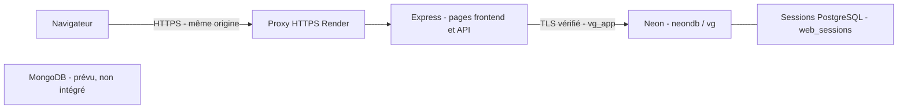

# Architecture et déploiement Render / Neon

## État confirmé - 18 novembre 2026

- Application : https://vite-et-gourmand-y9b8.onrender.com/
- Code public : https://github.com/abdoudoye/vite-et-gourmand
- Frontend HTML/CSS/JavaScript et API Express : même Web Service **Render Free**.
- PostgreSQL : **Neon**, base `neondb`, schéma `vg` ; serveur 18.7 lors du contrôle.
- Connexions client, employé et administrateur confirmées par le porteur ; catalogue,
  parcours client et réservation du stock confirmés en production.
- Dernier audit automatisé : **163 tests réussis, aucun échec**, sans nouvelle
  exécution pendant cette mise à jour. Tests mémoire/simulés distincts de la recette.
- MongoDB/statistiques non développés ; e-mails réels désactivés.

Le succès de ces parcours n'est pas une validation exhaustive des décisions employé,
de toutes les mutations administratives, du cycle de livraison ou d'une conformité
RGAA/RGPD. Les guides métier décrivent les fonctionnalités développées et leurs limites.

## Architecture



Le navigateur ne possède aucun accès direct à Neon. Express relit les droits métier
et utilise le compte technique restreint `vg_app`. `vg_owner` possède les objets sans
connexion directe (`NOLOGIN`) ; `vg_migrator` est réservé aux opérations manuelles
et peut prendre `vg_owner` par `SET ROLE`. Les rôles techniques sont différents des
rôles applicatifs `utilisateur`, `employe`, `administrateur`.

## Configuration du service Render

| Champ | Valeur |
| --- | --- |
| Type / instance | Web Service / Free, sans option payante |
| Runtime | Node |
| Dépôt / branche | `abdoudoye/vite-et-gourmand` / `main` |
| Root Directory | Vide : conserver `frontend/` et `backend/` accessibles |
| Build Command | `npm ci --prefix backend --omit=dev` |
| Start Command | `node backend/server.js` |
| Health Check Path | `/api/health/db` |
| Version Node prévue et testée localement | `NODE_VERSION=26.13.0` |

Le serveur écoute sur `HOST=0.0.0.0` et lit `PORT` fourni par Render. Ne pas fixer
`PORT` ni créer de variable `DATABASE_URL` : le code utilise les paramètres `DB_*`.
Aucune commande de migration ne doit être ajoutée au build ou au démarrage.
L'installation Linux du module natif Argon2 a permis le déploiement et les
connexions confirmées ; un nouveau changement de runtime doit être retesté.

## Variables d'environnement de production

À saisir dans la configuration privée Render, pas dans un fichier Git. Les éléments
entre chevrons sont des descriptions, jamais des valeurs à copier littéralement.

| Variable | Valeur / consigne |
| --- | --- |
| `NODE_VERSION` | `26.13.0` |
| `NODE_ENV` | `production` |
| `HOST` | `0.0.0.0` |
| `DB_HOST` | `<hôte Neon direct du projet, sans -pooler>` |
| `DB_PORT` | `5432` |
| `DB_NAME` | `neondb` |
| `DB_USER` | `vg_app` |
| `DB_PASSWORD` | `<secret technique privé de vg_app>` |
| `DB_SSL` | `true` |
| `SESSION_STORE` | `postgres` |
| `SESSION_SECRET` | `<secret aléatoire stable et distinct, au moins 32 caractères>` |
| `APP_ORIGIN` | `https://vite-et-gourmand-y9b8.onrender.com` |
| `TRUST_PROXY_HOPS` | `1` |
| `ORDER_EXTRA_PRICING` | `prorata` |
| `ORDER_TERMS_VERSION` | `DEMO-conditions-v1` |
| `EMAIL_MODE` | `disabled` |

`APP_ORIGIN` doit correspondre exactement à l'origine publique, sans slash final,
espace ou guillemets dans la valeur. Une origine différente produit 403
« Requête non autorisée » avant la vérification du mot de passe. Ne pas contourner
ce contrôle pour résoudre une erreur de configuration. Ne jamais fournir à Render
le mot de passe de `vg_migrator` ou du propriétaire initial Neon.

Cette table décrit la configuration attendue et la procédure employée ; les valeurs
secrètes actuelles du tableau de bord ne sont ni reproduites ni auditées ici.

## TLS, proxy et sessions

Le backend refuse une base distante avec `DB_SSL=false` et transmet
`rejectUnauthorized: true` à node-postgres, qui renseigne le nom d'hôte pour TLS.
Ne jamais configurer `rejectUnauthorized=false` ou `NODE_TLS_REJECT_UNAUTHORIZED=0`.
Node et psql n'utilisent pas nécessairement le même magasin de certificats :
l'installation psql Windows a nécessité un bundle CA vérifié hors dépôt. Il ne
faut pas copier un chemin Windows dans la configuration Render. Un éventuel
certificat supplémentaire doit faire l'objet d'une configuration contrôlée.

Les diagnostics psql ont utilisé `sslmode=verify-full`, l'hôte direct et un
`sslrootcert` explicite. `\conninfo` a confirmé TLS 1.3 côté client. La vue
`pg_stat_ssl` peut décrire le trajet interne vers PostgreSQL derrière le proxy Neon
et a renvoyé `false` : elle n'est pas utilisée seule comme preuve du TLS client.

Render termine HTTPS au proxy ; `TRUST_PROXY_HOPS=1` permet à Express de reconnaître
ce trajet. En production, le cookie est `__Host-vg.sid`, `Secure`, `HttpOnly`,
`SameSite=Lax`, chemin `/`, sans Domain, pour deux heures maximum. Les sessions sont
dans `vg.web_sessions`, avec un condensat du SID. Le secret doit rester stable
entre redémarrages. L'expiration est contrôlée, mais la purge périodique reste à
organiser. La survie d'une session à un redéploiement mérite une recette dédiée.

## Initialisation Neon et migrations déjà appliquées

**Ne pas rejouer cette initialisation sur la base de production existante.**
Le bootstrap technique a créé `vg_owner`, `vg_migrator` et `vg_app` par SQL pour
éviter les droits administratifs accordés à certains rôles créés via la console
Neon. Les rôles sont communs aux bases de la branche Neon ; les droits de base et
les objets de cette procédure ciblent `neondb`.

Le contrôle indépendant après migrations a constaté **24 tables, une vue,
cinq fonctions, sept triggers et aucune contrainte non validée**. Ordre appliqué :

| Script | Objet |
| --- | --- |
| `001_schema.sql` | Schéma métier, contraintes, fonctions et historique |
| `002_demo_data.sql` | Données entièrement fictives, comptes du seed inactifs |
| `004_registration_privileges.sql` | Catalogue/inscription avec permissions ciblées |
| `007_login_privileges.sql` | Colonnes nécessaires à l'authentification |
| `008_web_sessions.sql` | Sessions PostgreSQL et index d'expiration |
| `009_order_checkout.sql` | Devis, idempotence, distances et droits de commande/stock |
| `010_employee_privileges.sql` | Décisions employés et contacts |
| `011_admin_privileges.sql` | Employés, menus et avis côté administration |

L'application autorisée s'est faite dans un assemblage opérateur **hors Git**,
avec une transaction globale, contrôles après chaque étape et arrêt au premier
échec. Les bornes BEGIN/COMMIT externes des sources y ont été remplacées par la
transaction globale ; les sources du dépôt sont inchangées. Le contrôle des
permissions de séquences y utilise CASE pour n'appeler `has_sequence_privilege`
que sur `relkind='S'`. Les tentatives interrompues ont fait l'objet d'un contrôle
de rollback avant la tentative réussie ; COMMIT et code psql 0 ont été confirmés.

Ont été exclus : `000` (création locale), `003` (profil large), `005` (retour arrière),
`006` (diagnostic d'inscription ciblé) et `database/repairs/` (réparation locale).
Les privilèges par défaut de `vg_owner` retirent EXECUTE à PUBLIC sur ses futures
fonctions ; les contrôles ont vérifié cette protection sans rétablir 003.
Les fonctions de triggers ne sont pas directement exécutables par `vg_app` ;
les triggers restent actifs dans les opérations autorisées.

Une installation sur une autre base vide exige une nouvelle revue du bootstrap,
des sources et de l'assemblage, puis une autorisation. Le dépôt ne contient pas
un bootstrap Neon automatisé prêt à être relancé. Les scripts de provisionnement
du backend imposent `vite_et_gourmand` : ils ne sont pas compatibles tels quels
avec `neondb`. Les adaptations opérateur et secrets restent hors du dépôt.
Neon a refusé les mots de passe techniques préhachés transmis par `\password` ;
le provisionnement autorisé a utilisé une saisie masquée et des paramètres en mémoire
via TLS vérifié. Cela ne garantit pas l'absence de traces dans les systèmes internes
Neon. Cette opération technique est distincte des mots de passe applicatifs Argon2id.

## Vérifications de production

Lectures sans création de compte ou de commande :

```powershell
Invoke-RestMethod https://vite-et-gourmand-y9b8.onrender.com/api/health/db
Invoke-RestMethod https://vite-et-gourmand-y9b8.onrender.com/api/menus
```

La santé renvoie 200 avec `status: ok`, ou 503 avec `status: unavailable`. Le test
utilise une lecture SQL et le contrôle du rôle technique ; ce n'est pas un contrôle
exhaustif des tables ni des parcours. Le catalogue lit Neon et répond no-store ;
un onglet déjà ouvert peut conserver son instantané jusqu'à rechargement.
Sans session, `/api/auth/me` et les API privées doivent refuser l'accès ; un client
ne doit pas accéder aux API employé/admin, ni un employé aux API admin.

Validation confirmée : publication HTTPS, lectures de santé/catalogue, connexions
des trois rôles et parcours client/réservation selon le porteur. Restent à recetter :
chaque mutation employé/admin, persistance après redéploiement, concurrence réelle,
distances hors Bordeaux et accessibilité visuelle. Les connexions écrivent des
sessions et les scénarios métier modifient la base : les programmer avec autorisation.
Ne pas créer une commande uniquement pour un contrôle de santé.

## Limites gratuites et exploitation

Render Free peut s'arrêter après 15 minutes sans trafic entrant et prend environ
une minute pour redémarrer. Son disque est éphémère ; les sessions et données métier
sont donc dans Neon. Un réveil Neon peut retarder la première requête et provoquer
un échec temporaire des contrôles de santé, dont le budget est de cinq secondes.
Surveiller les quotas Render et Neon ; gratuit ne signifie pas disponibilité garantie.
Aucune option payante n'est nécessaire à la configuration décrite.

Render Free bloque les ports SMTP usuels 25, 465 et 587. `EMAIL_MODE=disabled` est
conservé : les notifications peuvent rester préparées en base, sans envoi réel.
Une intégration de messagerie adaptée serait une évolution distincte. MongoDB Atlas
et les statistiques restent non intégrés, même si cette cible a été retenue.

Ne pas publier de .env, mot de passe, hash de compte, chaîne de connexion avec secret,
bundle Git privé ou sauvegarde. Les identifiants applicatifs du jury doivent être
transmis séparément dans l'espace privé de remise Studi. Les comptes restent
accessibles pendant la correction ; leur rotation/désactivation exige une opération
autorisée ultérieure. Un changement documentaire n'est ni un commit ni un déploiement.

Références : [Render Web Services](https://render.com/docs/web-services),
[monorepo](https://render.com/docs/monorepo-support),
[limites Free](https://render.com/docs/free),
[santé](https://render.com/docs/health-checks),
[TLS node-postgres](https://node-postgres.com/features/ssl),
[rôles Neon](https://neon.com/docs/manage/roles).
